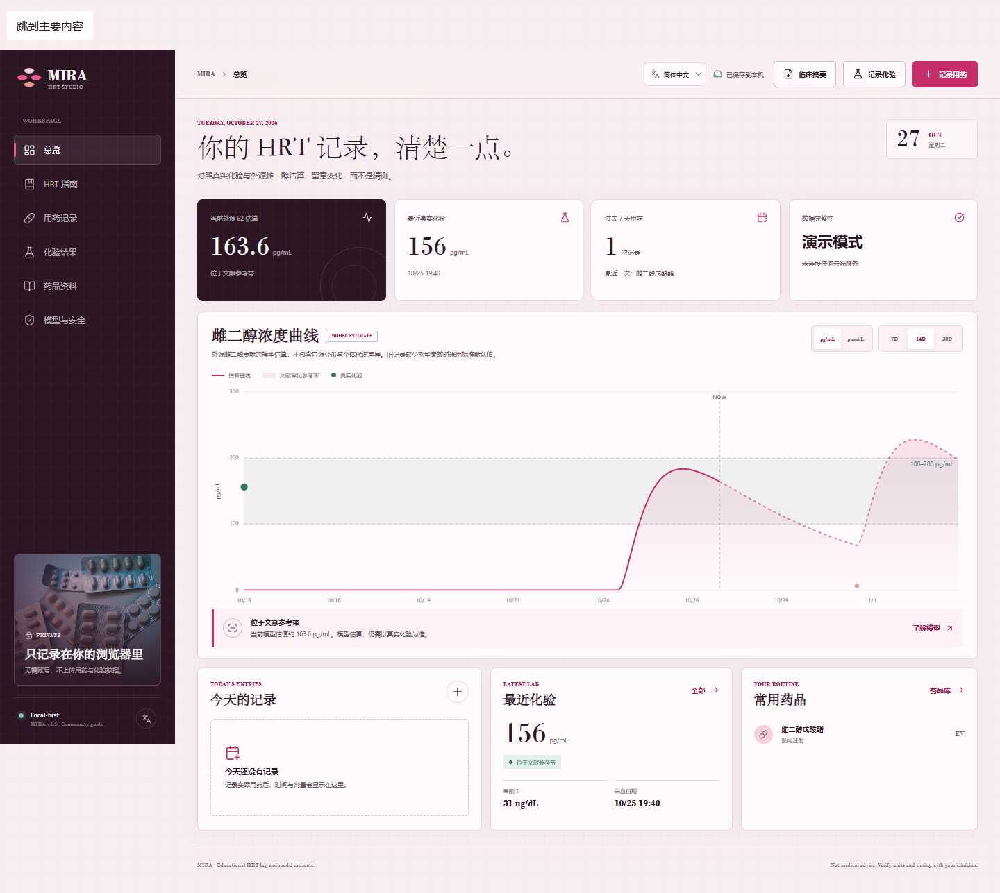
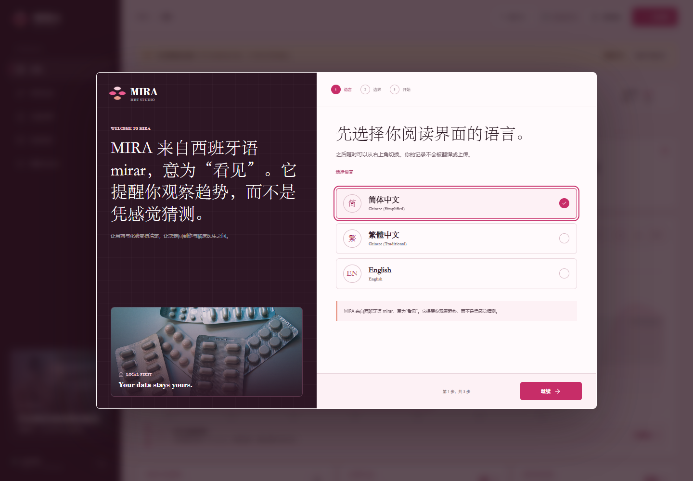
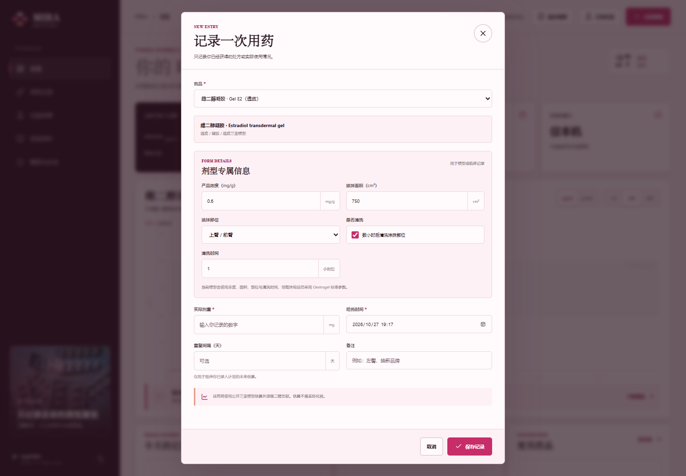
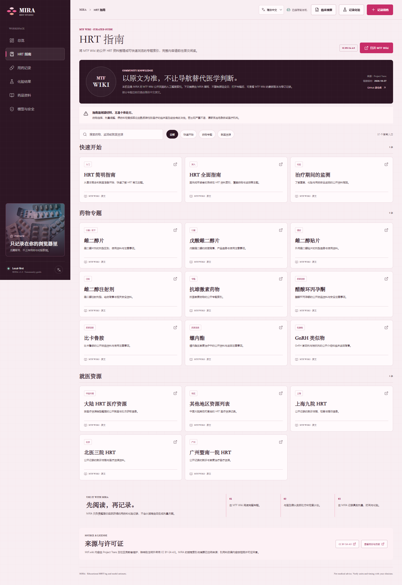
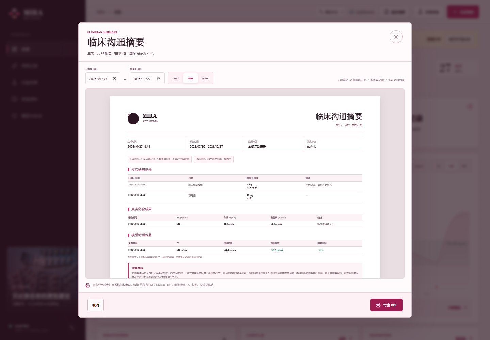

# MIRA · HRT 用药记录与浓度估算

MIRA 是一个面向跨性别女性、粉色风格且隐私优先的 HRT（激素替代 / 激素治疗）记录工具。你可以记录实际用药、真实化验和可选的重复计划，查看外源雌二醇的模型估算曲线，并导出自己的全部数据。





> **它不是血检设备，也不是医疗建议。** 曲线是公开人群药代参数的数学估算，不是实际血药浓度检测。不要根据模拟曲线自行开始、停止或调整用药。

首次打开会进入三步引导：选择界面语言、阅读模型与检测边界、决定从演示数据或空白记录开始。之后可在右上角切换语言，或从侧栏底部重新打开引导。

## 功能

- 今日总览、当前 E2 估算、最近真实化验、7 天用药统计
- 首次启动三步引导：语言、模型边界、演示数据或空白记录
- 简体中文、繁體中文与 English 界面，并可在应用内随时切换
- 独立的 MTF Wiki「HRT 指南」侧栏：快速开始、药物专题与中国大陆就医资源
- 交互式雌二醇浓度曲线，支持 7 / 14 / 30 天历史窗口和 7 天未来投影
- `pg/mL` 与 `pmol/L` 单位切换
- 真实 E2 化验以独立散点叠加对照
- 一页式 A4 临床沟通摘要：日期范围、实际给药、真实化验、观察残差与安全声明
- 通过系统打印窗口导出 PDF，保留中文、繁体和英文原文
- 用药记录：药品、实际剂量、时间、备注、可选重复间隔
- 用药记录支持编辑；旧记录可以补充剂型参数而不会重复叠加剂量
- 剂型专属参数：凝胶浓度/面积/部位/清洗、舌下含服时间/吞咽、口服饮食、注射载体与部位、贴片品牌与更换周期
- 化验记录：E2、睾酮、催乳素与单位自动换算
- 16 种常见雌激素、抗雄激素、GnRH 激动剂和孕激素资料条目
- 药品搜索、类别筛选、剂型说明和公开来源
- 真实 E2 化验趋势图
- JSON 全量备份、导出 / 导入、CSV 用药导出
- 本地存储，无需账号，不上传用药与化验数据
- 响应式桌面 / 手机界面与键盘可访问性

## 浓度模型

目前实际支持：

- 雌二醇戊酸酯注射剂
- 雌二醇环丙酸酯注射剂
- 雌二醇庚酸酯注射剂
- 雌二醇苯甲酸酯注射剂
- 雌二醇十一酸酯注射剂
- 每周更换一次或两次的雌二醇透皮贴片
- 口服雌二醇片
- 舌下 / 颊黏膜雌二醇片
- 雌二醇透皮凝胶

注射剂与贴片模型改编自 MIT 许可的 [estrannaise.js](https://github.com/WHSAH/estrannaise.js)；口服、舌下和凝胶模型改编自 MIT 许可的 [Transmtf HRT Tracker](https://github.com/TransmtfTeam/Transmtf-HRT-Tracker)。完整署名和许可证记录在 [THIRD_PARTY_NOTICES.md](THIRD_PARTY_NOTICES.md)。

抗雄药、GnRH 激动剂与孕激素可正常记录，但暂不显示雌二醇曲线，因为它们的作用机制、活性代谢物或缓释行为不能直接套用雌二醇模型。详细限制见 [MODEL.md](MODEL.md)。

### 为什么记录后没有曲线？

如果药品卡或今日记录旁显示 **仅记录**，说明该药物暂不在当前雌二醇浓度模型内。抗雄药、GnRH 激动剂和孕激素仍会保存到用药历史和临床摘要，但不会生成模拟曲线。口服、舌下与凝胶采用固定的人群假设，真实吸收会因产品、使用方式和个体差异明显变化。

### 剂型专属输入



- 凝胶：浓度、涂抹面积、部位、清洗时间会参与模型。
- 舌下：含服时间与是否吞咽会参与模型。
- 口服：饮食时机会写入记录和临床摘要，当前不施加未经校准的饮食修正。
- 注射：载体油与注射部位会写入记录，当前不改变药代参数。
- 贴片：品牌会写入记录；更换周期用于未来投影，贴片释放参数仍由剂型模型决定。

所有结构化信息都会保存在本机、JSON/CSV 导出和临床沟通摘要中。

## 关于 MIRA

MIRA 不是医学缩写，也不是药名。这个名字取自西班牙语 **mirar**（看见）——提醒使用者观察实际记录和趋势，同时把判断留给专业临床沟通。

## 本地运行

只需要 Node.js 18 或更高版本，不需要安装依赖。

```bash
node scripts/serve.mjs
```

打开 [http://127.0.0.1:4173](http://127.0.0.1:4173)。

运行测试：

```bash
node --test
```

## MTF Wiki 指南

“HRT 指南”栏目将 MtF.wiki 的公开专题整理为应用内索引，并提供原文链接。它不是 MtF.wiki 官方客户端，也不复制整站文章。



指南内容由 [Project Trans 与社区贡献者](https://github.com/project-trans/MtF-wiki) 维护，除特别注明外采用 [CC BY-SA 4.0](https://creativecommons.org/licenses/by-sa/4.0/) 许可。MIRA 编写的导读文本同样按该许可共享；应用代码继续采用 MIT。

## GitHub Pages 部署

1. 创建 GitHub 仓库并推送 `main` 分支。
2. 打开仓库的 **Settings → Pages**。
3. 将 **Source** 设置为 **GitHub Actions**。
4. `.github/workflows/pages.yml` 会在测试通过后自动发布。

## 导出临床摘要



1. 使用真实记录登录工作台，演示数据不会被允许作为临床摘要导出。
2. 点击顶栏 **临床摘要**，或从化验/安全页面打开。
3. 选择起止日期，核对预览中的用药、化验和模型残差。
4. 点击 **导出 PDF**，在系统打印窗口选择 **另存为 PDF**，纸张选择 A4 纵向。

一页摘要最多展示最近 8 条用药、6 条化验和 4 条可对照残差，并明确标注完整总数。更久或更密集的数据请使用 CSV / JSON 导出。

## 项目结构

```text
.
├── assets/
│   ├── app.js
│   ├── chart.umd.min.js
│   ├── clinical-summary-preview.png
│   ├── favicon.svg
│   ├── hrt-guide-preview.png
│   ├── lucide.min.js
│   ├── medication-still-life.jpg
│   ├── onboarding-preview.png
│   ├── opencc.full.js
│   ├── preview.png
│   ├── route-inputs-preview.png
│   └── styles.css
├── licenses/
├── scripts/
│   └── serve.mjs
├── src/
│   ├── data.js
│   ├── guide.js
│   ├── i18n.js
│   ├── model.js
│   └── report.js
├── tests/
│   ├── guide.test.js
│   ├── i18n.test.js
│   ├── model.test.js
│   └── report.test.js
├── index.html
├── MODEL.md
└── THIRD_PARTY_NOTICES.md
```

## 隐私

所有记录都保存在当前浏览器的 `localStorage` 中。应用不包含账号系统、分析脚本、远程数据库或上传接口。导出文件由用户主动下载。

## 医学与数据边界

- 参考带仅用于展示公开指南中的常见监测范围，不是所有个体适用的治疗目标。
- 模型不包含内源雌二醇、个体差异、全部药物相互作用或实验室误差。
- 不同地区、制剂和实验室之间可能不可直接比较。
- 任何用药或检查决定应由合格临床医生结合完整病史作出。
- 本项目没有复制第三方项目中未获许可的数据；所采用的 MIT 代码和参数均附有许可证与署名。

## 素材与许可

源代码采用 [MIT](LICENSE)。图表库 Chart.js、图标库 Lucide、繁简转换库 OpenCC-JS 与药代模型来源的许可证见 [THIRD_PARTY_NOTICES.md](THIRD_PARTY_NOTICES.md)。

界面静物照片来自 Unsplash，保存在 `assets/medication-still-life.jpg`，不包含在项目 MIT 授权范围内。
